# CyberQuest admin guide

This guide is for the people who run CyberQuest day to day: writing practice sessions,
publishing blog posts and handling reports from members. You don't need to know any code.

All the pictures come from a demo site. The people in them (Rina, Omar, Lena, demo_alex and
demo_sam) are made up.

**Where to sign in:** go to `/admin-login/` on the site and sign in with your staff account.
You land in the **Command Center**. The menu on the left only shows the areas your account
can use.

---

## 1. Who can do what

| | Content Editor | Content Publisher | Moderator |
|---|---|---|---|
| Create, copy and edit practice sessions (drafts) | ✓ | ✓ | |
| Preview a draft in the real player | ✓ | ✓ | |
| Ask for a review | ✓ | | |
| **Publish**, archive, un-archive, restore old versions | | ✓ | |
| Write and publish blog posts | | ✓ | |
| Handle reports about messages | | | ✓ |

- **Content Editor:** prepares sessions. Editors can't make anything visible to students.
  When a draft is ready, they press **Request review** and the publishers get a notification.
- **Content Publisher:** everything an editor can do, plus decides what students see.
  Publishers also run the blog.
- **Moderator:** sees only the Moderation area. Moderators never browse members' messages.
  They see a message only when a member reports it (see section 7).
- **Superuser** (the site owner): can do everything.

The buttons follow these rules, and the server checks them again on every action. Even
someone who tries to send a request by hand can't do more than their role allows.

---

## 2. Your first session in 5 minutes

The quickest way to make a new session is to copy a built-in one and change its words. The
steps, the answers and the scoring come with the copy.

**1. Open the Practice Studio** and press **New practice session**.

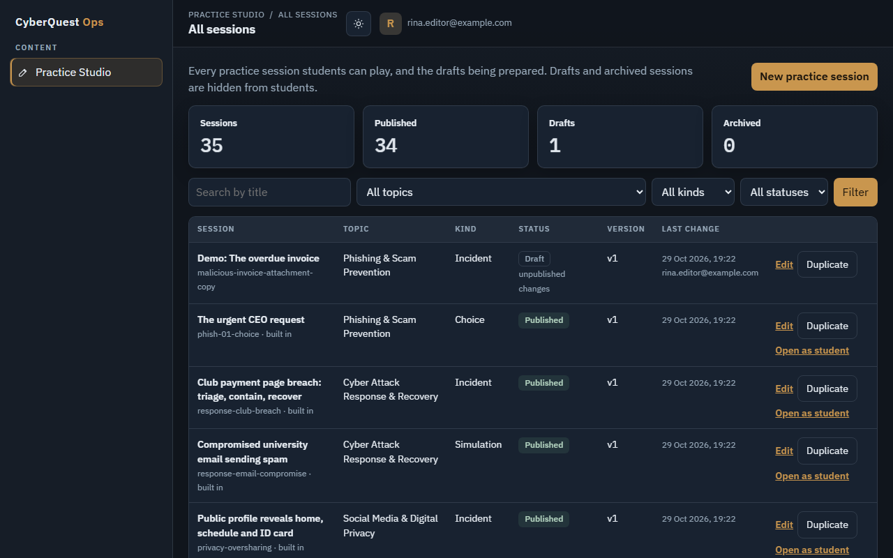

**2. Choose "Duplicate a session".** (You can also start from a template or import a file.
"Generate from Topic Kit" is coming later.)

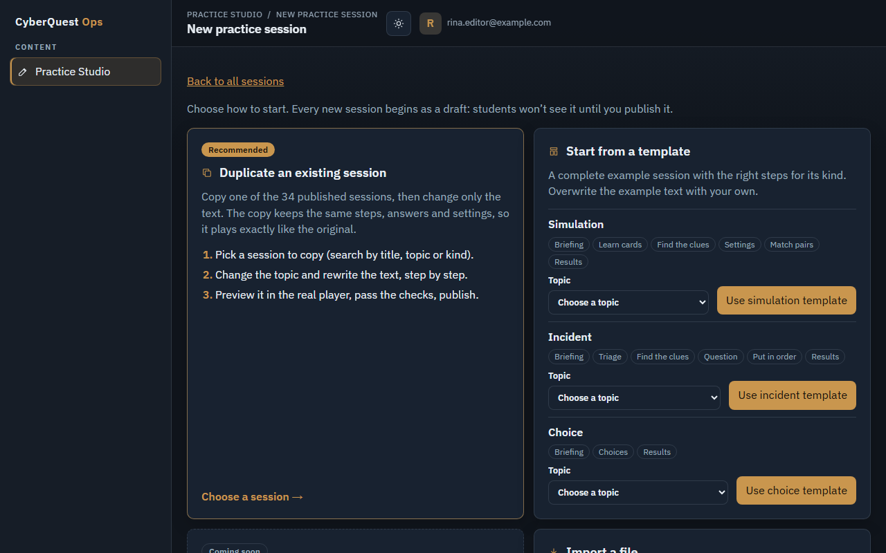

**3. Pick the session to copy** and press **Duplicate**. The copy is a new **draft**.
Students can't see drafts.

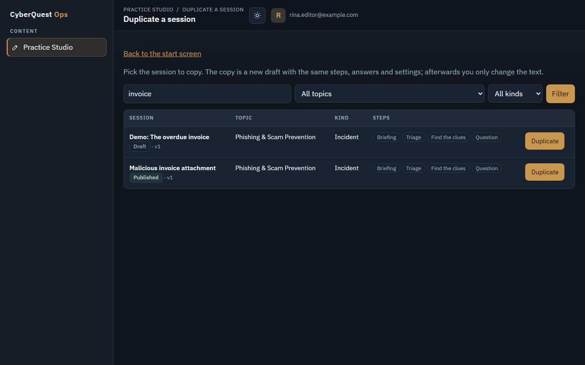

**4. Basics:** give it a title, topic, difficulty and time. Every practice session is worth
the same 50 XP, so XP can't be changed. There are no timers.

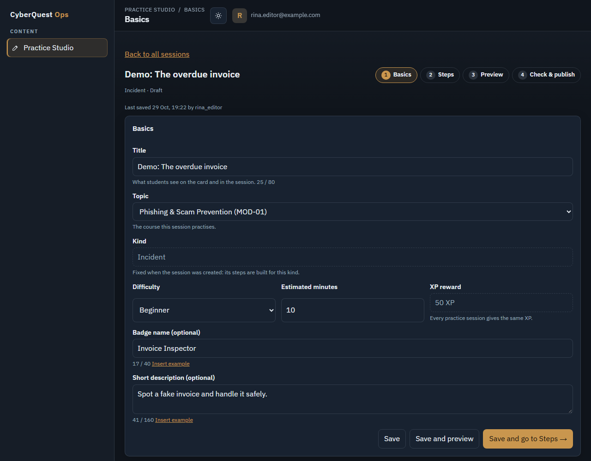

**5. Steps:** change the text on each card. Your work saves itself every 30 seconds, and the
**Save** button saves straight away. The "Insert example" links fill in a sample you can edit.

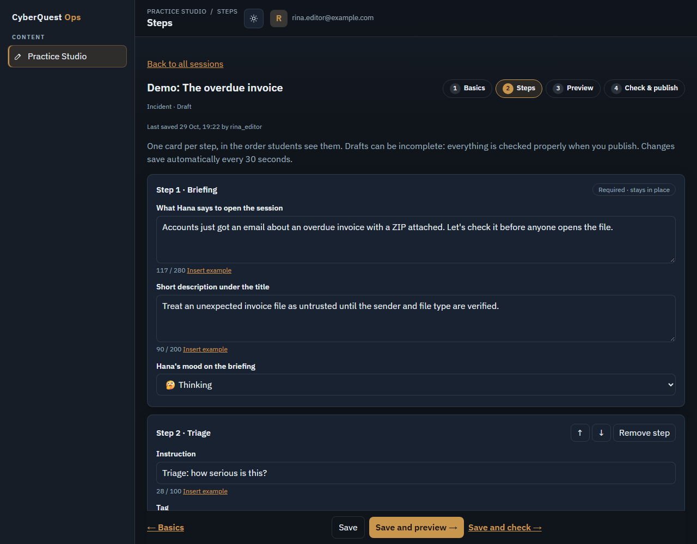

**6. Preview:** press **Save and preview** to play the session exactly as a student would.
Previews give no XP and don't count in anyone's stats. The **Answer key** on the right shows
the right answers. Students never see it. Use **Mobile (390 px)** to check it on a phone-sized
screen.

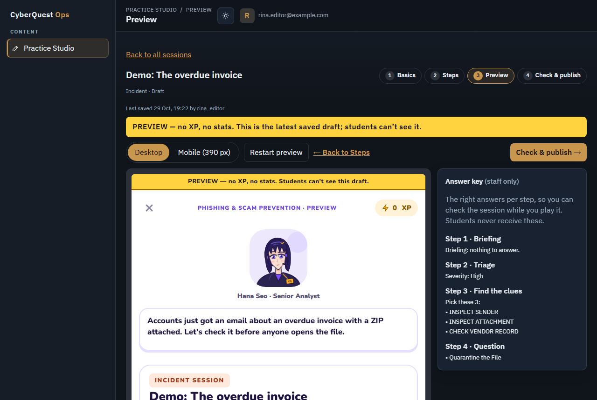

**7. Check & publish:** this page runs every check and lists the result in plain English.
Anything that needs fixing has a **Fix** link that takes you to the exact box. If you are an
editor, press **Request review** when everything is ticked.

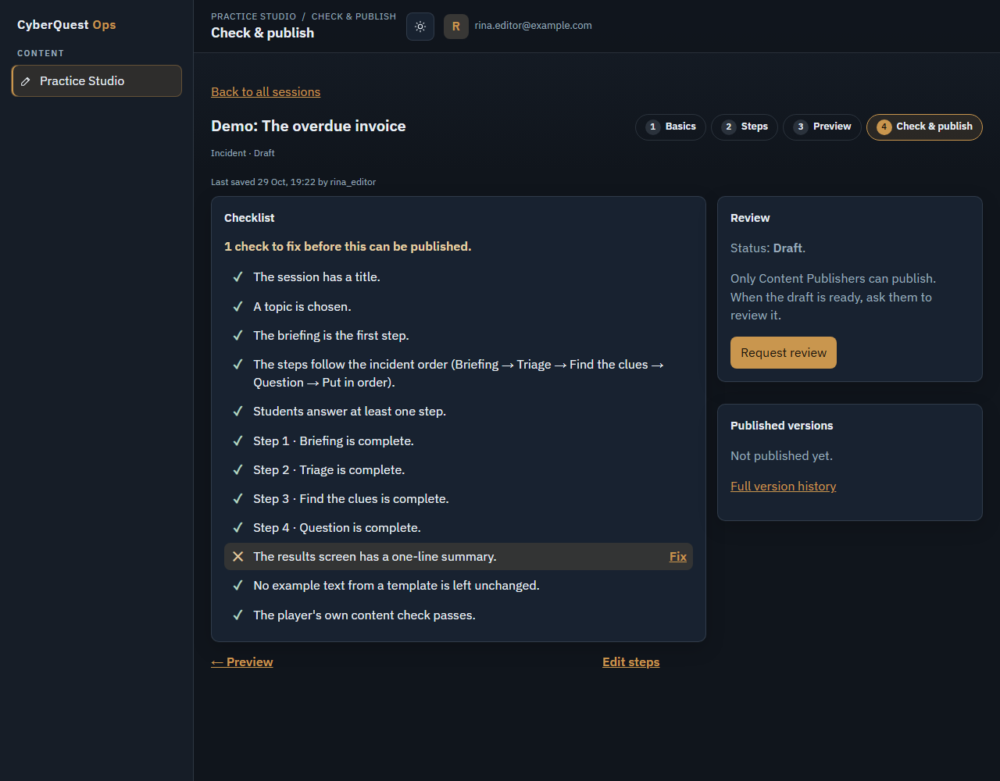

**8. Publish (publishers):** when every check passes, press **Publish…**. A box asks you to
confirm, because students will see this version immediately.

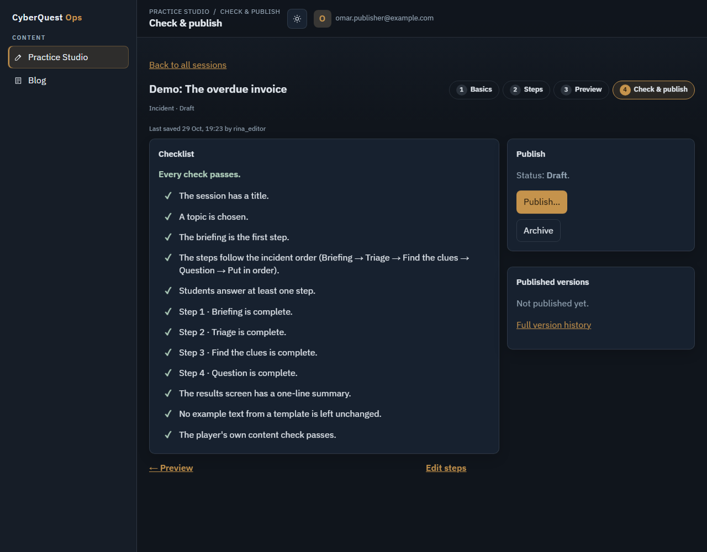

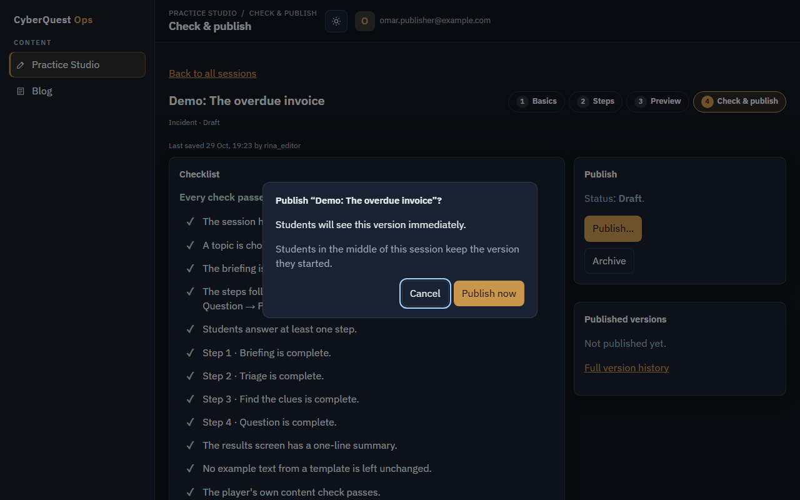

That's it: the session is now in the Practice Center for students.

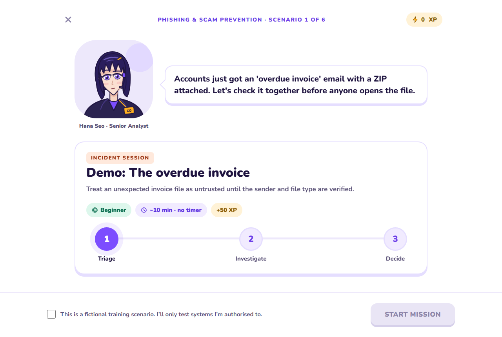

---

## 3. The step types

Each kind of session has a fixed order of steps. A **Question** step can stand in for any
step except the briefing.

- **Simulation:** Briefing → Learn cards → Find the clues → Settings → Match pairs
- **Incident:** Briefing → Triage → Find the clues → Question → Put in order
- **Choice:** Briefing → Choices

**Briefing.** Hana, the guide character, introduces the situation in one or two sentences,
with a short description under the title. Every session starts with it. Use it to set the
scene: who is affected, and what just happened.

**Learn cards.** Exactly three flip cards, each with a short title and a one-line explanation.
Nothing is graded. Use them to teach the three ideas students need before the hands-on part.

**Find the clues.** A list of details, such as a sender, a link or an attachment. Students
pick the suspicious ones, and you tick which items are the clues. Use it whenever "spot what's
wrong" is the skill: emails, login pages, logs, file details.

**Settings.** Each setting (for example "Encryption" or "Sharing") has three options, from
weakest to strongest, and you mark the secure one. Use it to practise locking something down:
accounts, Wi-Fi, a shared folder.

**Question.** One question with three or four answers. Tick the right answer, and add a short
explanation per answer if you like. Use it for a key decision: "What do you do first?"

**Triage.** One or more alerts, and students choose how serious it is (Low to Critical). You
choose the right level. Use it at the start of an incident, to train judging urgency.

**Put in order.** Two to eight actions, entered in the correct order. Students see them
shuffled. Use it for procedures: the steps of responding to a breach, for example.

**Match pairs.** Two to six problem → fix pairs. Students see the right-hand column shuffled.
Use it as a quick recap at the end.

**Choices.** Three short scenes, each with three choices marked Good, Risky or Bad, and what
happens next. The choices move two meters (for example Security and Team trust) and lead to
one of three endings. Use it for "what would you do?" stories where people, not settings, are
the risk.

**Results screen.** Always last: a heading, a one-line summary and up to six "what you
practised" lines.

---

## 4. What students see, at each stage

| Stage | What students see |
|---|---|
| **Draft** (new, or unpublished changes) | Nothing new. A brand-new draft is invisible. For a published session, students keep the published version until you publish again. |
| **Preview** | Nothing. Previews are only for Studio staff. |
| **Published** | The new version, straight away, in the Practice Center. Anyone who was halfway through the old version finishes it and is graded on it. |
| **Archived** | The session disappears from the Practice Center, and its page can't be opened. Students' history, scores and XP stay exactly as they were. |

---

## 5. Version history, restore and archive

**Version history** lists every version students could play: its number, who published it,
when, and what changed (title, minutes, steps added, removed or edited).

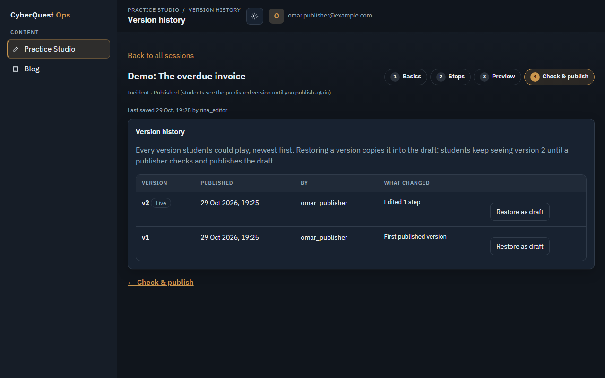

**Restore as draft** copies an old version into the draft. It does **not** publish. Students
keep seeing the live version until a publisher checks the restored draft and publishes it.
This is also the way to throw away unwanted changes: restore the live version.

**Archive** (shown as **Unpublish (archive)** on a published session) hides a session from
students without deleting anything. **Un-archive** brings it back exactly as it was. Both ask
you to confirm, and every publish, archive, un-archive and restore is recorded with your name.

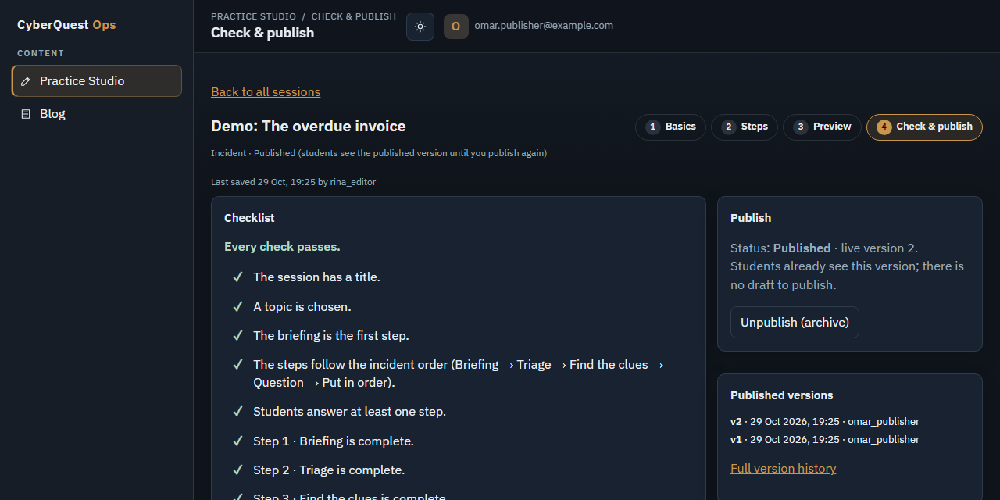

---

## 6. The blog (Content Publishers)

1. **Blog → New post.** Write a title, a one- or two-sentence excerpt, and the body. The body
   uses simple formatting (Markdown): `## Heading`, `**bold**`, `- list item`,
   `[link text](https://…)`. The "Markdown cheat sheet" under the box lists them all. HTML
   typed into a post is shown as plain text.
2. **Save draft.** Drafts are private. The **private preview** link on the right shows the post
   as readers will see it. Only blog editors can open it.
3. **Images:** put the cursor where the picture should go and press **Insert image**. Choose
   the file and describe the picture in **Alt text** (required: it is read aloud to people who
   can't see the image). The picture is checked, resized and cleaned of location and camera
   data, and its line appears at the cursor. Then **Save**. To make an image the cover, use
   **Use as cover** in the Images panel.
4. **Publish.** You are asked to confirm. The post appears at `/blog/<address>/`. The address
   is fixed from the first time a post is published, so links to it never break, even if you
   change the title later. **Unpublish** turns it back into a draft.

If you try to leave the page with unsaved changes, the browser warns you.

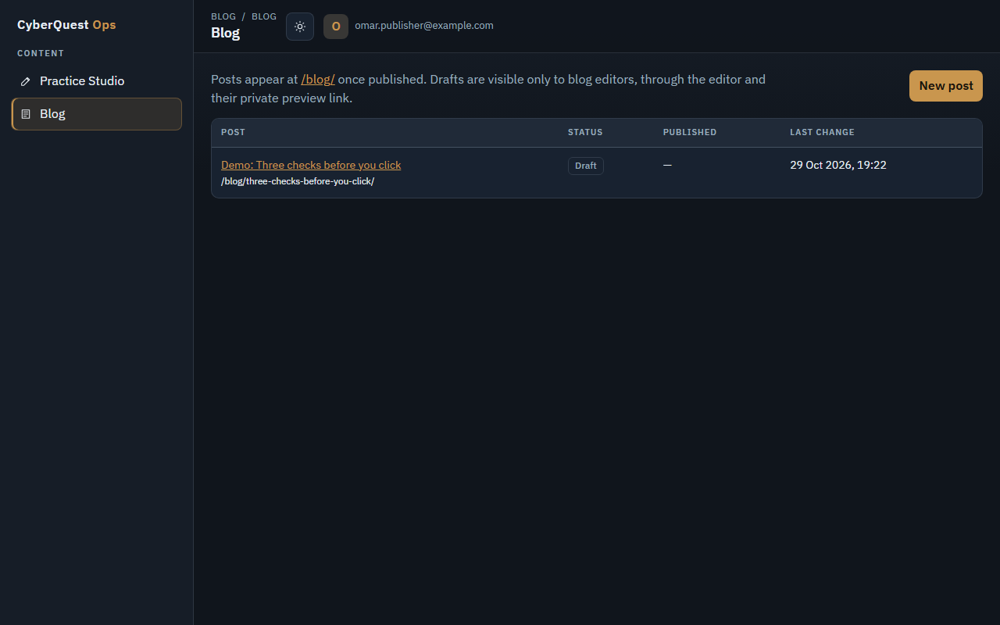

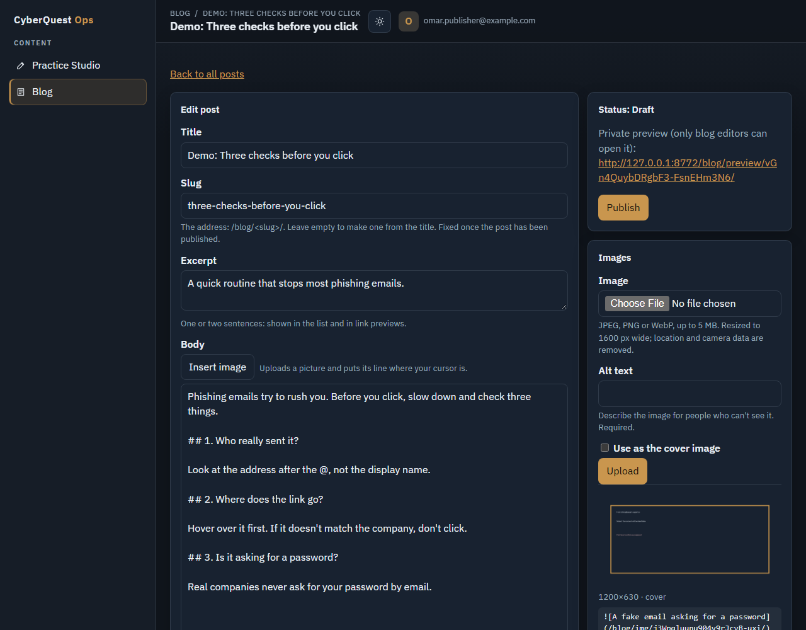

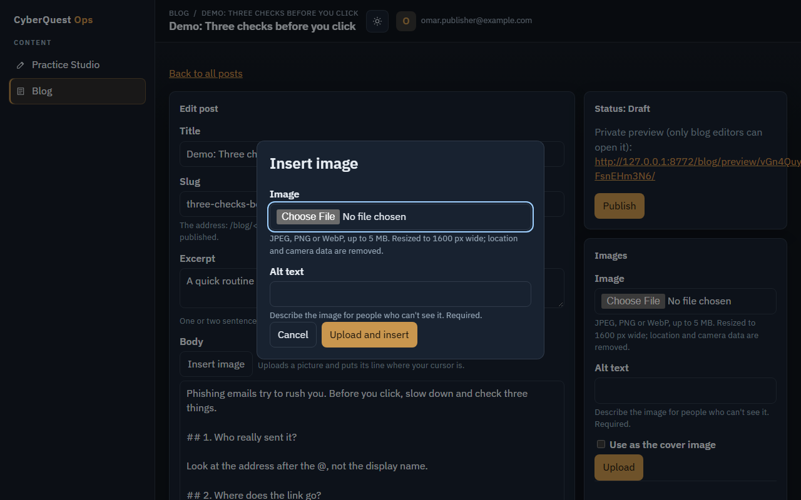

---

## 7. Moderation (Moderators)

**When can a moderator read a message?** Only when a member reports it, and only after
pressing **Show reported message**. Every time this is done, it is written to the moderation
log with the moderator's name and the time. Moderators can't browse conversations, search
messages, or read anything that hasn't been reported.

1. **Reports** lists the open reports: the reason, who it is about and who sent it. Reports
   you filed, or that are about you, go to another moderator.

   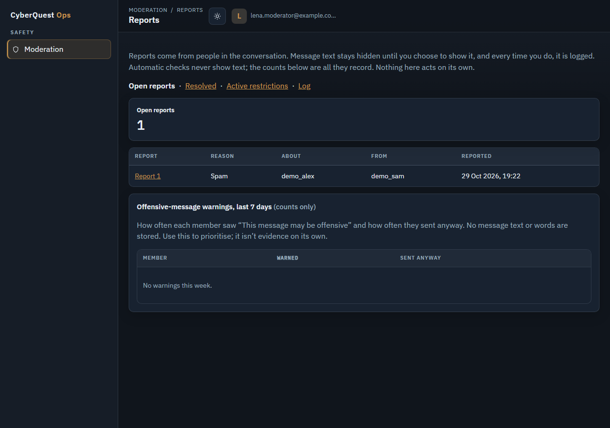

2. Open a report. The message stays hidden until you choose to show it.

   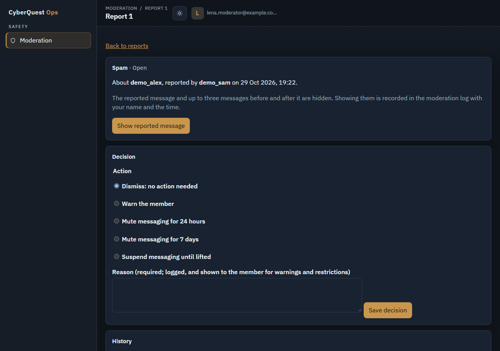

3. **Show reported message** shows the reported message (highlighted), up to three messages
   around it, and the reporter's note.

   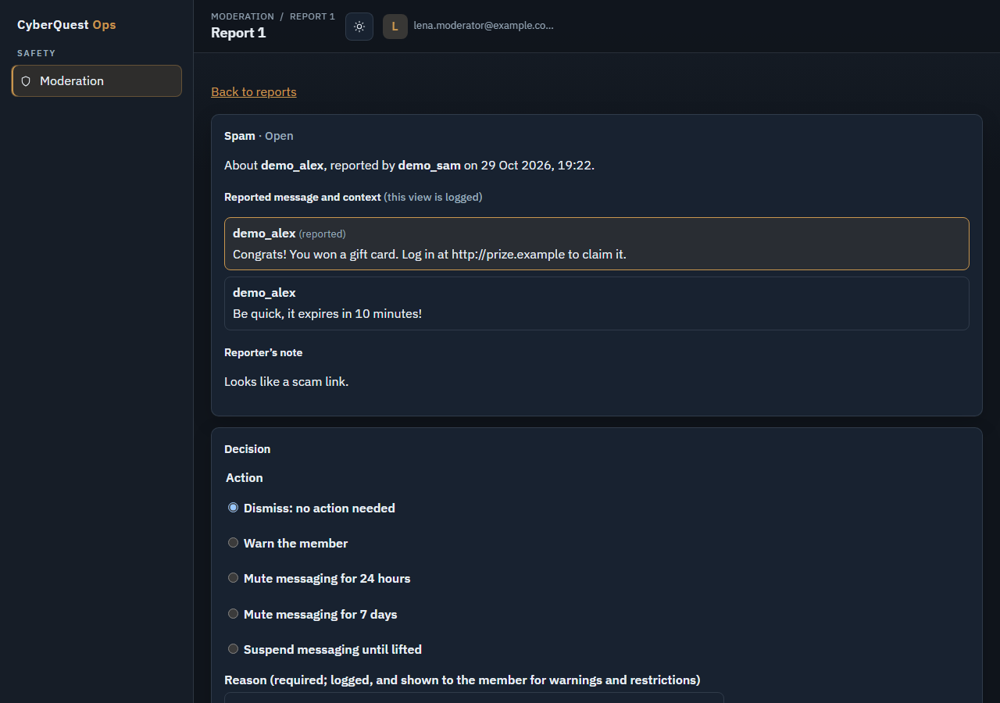

4. **Decide:** dismiss, warn, mute messaging for 24 hours or 7 days, or suspend messaging until
   lifted. A reason is always required. For warnings and restrictions, the member is told the
   reason. Anything other than "Dismiss" asks you to confirm.
5. **Active restrictions** lists current mutes and suspensions. Mutes end on their own. To lift
   one early, enter a reason and press **Lift**.
6. **Log** shows every action and every time a message was shown. It can't be edited or
   deleted. After 180 days, the reason text and the report link are removed.

The "Offensive-message warnings" box only counts how often members were warned that a message
might be offensive, and how often they sent it anyway. It never stores the words. Use it to
decide what to look at first. It isn't evidence on its own.

---

## 8. Good to know

- **Two people editing the same draft:** if someone else saved first, you are told who and
  when. Your text stays on screen so you can copy it, then reload.
- **Signed out while editing:** you get a message and your typing is kept. Sign in again in
  another tab, then save.
- **Everything is logged:** creating, editing, publishing, archiving, restoring and review
  requests in the Studio; every action and message view in Moderation.
